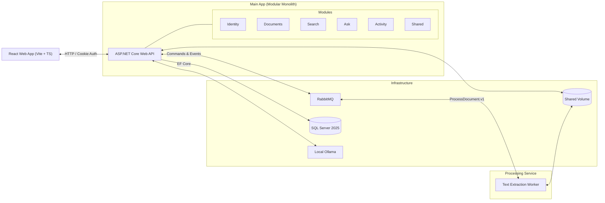

# Personal Document Organizer: Project Lore

Welcome to the **Project Lore** for the Personal Document Organizer. This repository documentation captures the complete system blueprint, requirements, architectural decisions, setup guides, and development scripts derived from the project roadmap in [Map.md](file:///Users/balajinadakuditi/Repos/Personal%20Document%20Organizer/project-lore/Map.md).

---

## What is the Personal Document Organizer?

A private-first document organizer that allows you to store PDFs, Word documents, text files, and images, search through them via full-text keyword indexing, and ask questions answered with precise citations. 

All AI and data processing runs entirely on your local machine using Docker Compose, SQL Server, RabbitMQ, and Ollama.

---

## Directory Structure

```text
project-lore/
├── README.md                     # This file (lore index & quick navigation)
├── Map.md                        # Master source roadmap
├── requirements/                 # Product specs, security rules, roadmap phases
│   ├── 01-vision-and-scope.md    # Product vision, audience, scale, limits
│   ├── 02-security-principles.md # The 7 non-negotiable security rules
│   ├── 03-features-by-tier.md    # v1, v2, Later, and feature cut order
│   ├── 04-roadmap-and-phases.md  # Detailed Phase 0 to 7 breakdown & gates
│   └── 05-testing-strategy.md    # Test pyramid, authorization suite, evaluation
├── architecture/                 # System architecture, schemas, and contracts
│   ├── 01-system-overview.md     # Two-program design & high-level architecture
│   ├── 02-modules-and-boundaries.md # Modular monolith rules & public interfaces
│   ├── 03-data-models-and-schemas.md # Per-module schemas, tables & state machines
│   ├── 04-contracts-and-messaging.md # RabbitMQ messages, in-process events, errors
│   └── 05-tech-stack.md          # Technology decisions (.NET 10, React, SQL Server)
├── decisions/                    # Architectural Decision Records (ADRs)
│   ├── ADR-001-modular-monolith-and-worker.md
│   ├── ADR-002-technology-stack.md
│   ├── ADR-003-cookie-auth-and-spaces.md
│   ├── ADR-004-outbox-and-messaging.md
│   ├── ADR-005-file-storage-strategy.md
│   └── ADR-006-local-ai-and-vector-search.md
├── setup/                        # Environment setup & onboarding guides
│   ├── 01-prerequisites.md       # Required developer tooling (.NET 10, Docker, Node)
│   ├── 02-docker-compose-guide.md # Multi-container infrastructure setup
│   ├── 03-phase-0-quickstart.md  # First week bootstrapping guide
│   └── 04-troubleshooting.md     # Common issues and failure recovery drills
└── scripts/                      # Developer and verification scripts
    ├── README.md                 # Scripts documentation and usage
    ├── verify-phase0.sh          # Phase 0 environment verification
    └── process-file.sh           # Standalone file processing test helper
```

---

## System at a Glance



---

## The 7 Non-Negotiable Rules

Every rule must be provable by an automated test:
1. **Originals are never overwritten:** Source files stay immutable; modifications create new versions.
2. **Every artifact ties to a document version:** Derived chunks, text, and embeddings link to a specific version.
3. **Access is checked on every path:** User A cannot access User B's spaces across API, search, export, or Ask.
4. **Personal space can never be shared:** A Personal space cannot have a second member added.
5. **Document text is untrusted input:** Instructions inside files cannot manipulate prompt behavior.
6. **Errors use stable codes, never content:** Logs and error messages never leak file contents.
7. **AI runs locally and respects a per-space switch:** Documents stay local, and indexing stops when AI is off.

---

## Glossary

| Term | Plain English Meaning |
| --- | --- |
| **Modular Monolith** | One single backend program built from strictly isolated modules with private internals. |
| **Worker Service** | An independent background process (`Processing`) that runs text extraction jobs. |
| **Outbox Pattern** | Storing outgoing messages in the database in the same transaction as domain updates before dispatching. |
| **Idempotent** | Handling the same message multiple times results in the same single state outcome. |
| **RAG** | Retrieval-Augmented Generation: finding matching document passages and supplying them as citations to an LLM. |

