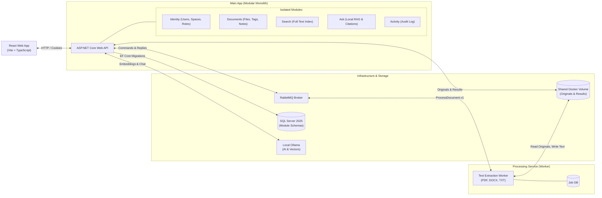

# Architecture: System Overview

## The Two-Program Design

The Personal Document Organizer is intentionally built as **two separate programs**:
1. **Main App (`src/App`):** A modular monolith housing the Web API, business domains, data persistence, and user interfaces.
2. **Processing Service (`src/Processing`):** An isolated worker process with one single responsibility: turning raw files into clean text, page streams, and metadata.

---

## Program Responsibilities

| Program | Core Responsibility | What It Owns | What It Never Does |
| --- | --- | --- | --- |
| **Main App** | User authentication, space management, document tracking, tagging, notes, search queries, RAG Q&A, and public HTTP APIs. | The main database (schemas: `identity`, `documents`, `search`, `ask`, `activity`) and original file uploads. | **Never parses or reads the raw contents of uploaded files to extract text.** |
| **Processing Service** | Converts files (PDF, DOCX, TXT) into structured text pages, counts, and metadata. | Its own private job database and the extracted results JSON storage folder. | **Never knows about users, spaces, tags, notes, or access control rules.** |

---

## Why One Real Service Boundary?

Instead of adopting microservices (which introduces network latency, service meshes, distributed transactions, and operational complexity), this architecture introduces exactly **one real boundary**:
* **Learns Distributed Systems:** You master async messaging, message serialization, idempotent consumers, retries, dead-letter queues, and distributed tracing without microservice overhead.
* **Separation of Compute:** Heavy text extraction and PDF parsing will not starve or block the responsive Web API serving user requests.
* **Failure Isolation:** If a corrupt document crashes the PDF parser, the web app stays online. Uploaded files safely wait in the queue until the worker recovers.

