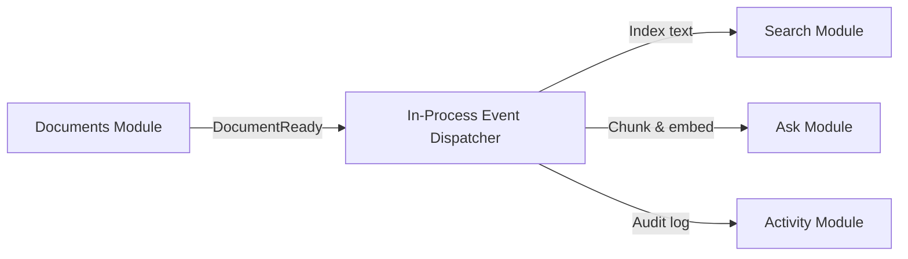

# Architecture: Modules and Boundary Rules

## Modular Monolith Structure

The Main App is structured as a **modular monolith**. Each module represents a distinct domain boundary packaged as a separate C# project or namespace. Modules run within the same host process and share database connections, but enforce strict boundaries as if they could be deployed as independent microservices in the future.

```text
src/
├── App/                 # Web API host, middleware, DI registration
└── Modules/
    ├── Identity/        # Authentication, spaces, memberships, roles
    ├── Documents/       # File tracking, versions, tags, notes, outbox
    ├── Search/          # Full-text keyword index, query parser
    ├── Ask/             # Chunks, vector embeddings, Ollama RAG
    ├── Activity/        # Append-only audit logging
    └── Shared/          # Primitives, IDs, Result types, stable ErrorCodes
```

---

## Module Breakdown

| Module | Core Responsibility | Database Schema | Public Interface Exposed |
| --- | --- | --- | --- |
| **Identity** | Users, session authentication, spaces, memberships, role checks. | `identity` | `IIdentityApi` (e.g. `GetAllowedSpaces`) |
| **Documents** | Document metadata, versions, space-scoped tags, notes, upload outbox. | `documents` | `IDocumentsApi` |
| **Search** | Indexed page tokens, custom AST query parser, full-text queries. | `search` | `ISearchApi` |
| **Ask** | Document chunking, vector generation, similarity search, Ollama Q&A. | `ask` | `IAskApi` |
| **Activity** | Append-only audit record of domain actions. | `activity` | `IActivityApi` |
| **Shared** | Strongly-typed IDs, generic `Result<T>`, stable `ErrorCodes`. | *(No DB tables)* | Open to all modules |

---

## The 5 Inviolable Module Rules

1. **Small Public Facades:** A module exposes only a compact public interface (e.g., `IIdentityApi`, `IDocumentsApi`). All entity classes, repositories, internal DTOs, and DbContexts must be `internal`.
2. **Schema Isolation:** A module **never** reads or writes another module's database tables. Cross-module data access must go through the public interface or respond to an in-process domain event.
3. **No Direct Authorization in Search/Ask:** Modules like `Search` and `Ask` never evaluate user permissions themselves; they receive pre-verified `spaceIds` from `Identity` or the API layer.
4. **Minimal Shared Kernel:** The `Shared` project is strictly limited to primitive value objects, strongly-typed IDs, error codes, and shared interfaces (such as `IMessageBus` and `IFileStore`). Business domain entities are never placed in `Shared`.
5. **Automated Architecture Tests:** Architectural rules are codified in `tests/Architecture.Tests/` using NetArchTest. If any module references internal types or tables of another module, the build immediately fails.

---

## In-Process Event Dispatcher

Modules communicate asynchronously inside the Main App process using a lightweight in-process event dispatcher (~30 lines of code) rather than heavy message queues:



### Supported In-Process Events

| Event | Raised By | Handled By | Meaning |
| --- | --- | --- | --- |
| `DocumentReady` | Documents | Search, Ask, Activity | Processing finished extraction; text is ready for indexing and chunking. |
| `DocumentDeleted` | Documents | Search, Ask, Activity | A document was removed; delete corresponding indexed pages and chunks. |
| `SpaceSettingsChanged` | Identity | Ask | Space AI toggle changed; delete chunks if AI was turned off. |
| `ActionRecorded` | Any Module | Activity | Record an audit entry (login, upload, edit, delete, export). |

