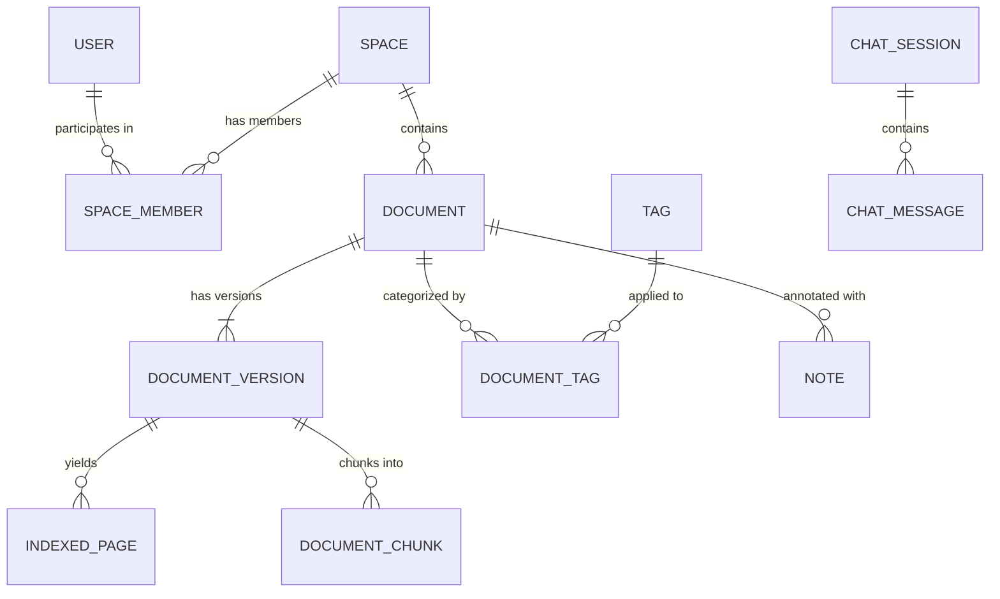
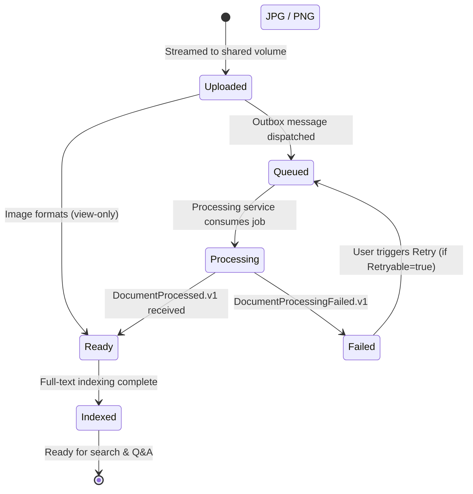

# Architecture: Data Models and Schemas

## Schema Segregation in SQL Server

The main application database segregates module tables into separate SQL Server schemas: `identity`, `documents`, `search`, `ask`, and `activity`. The Processing Service maintains its own distinct database.

---

## Detailed Table Definitions

### 1. Identity Module (Schema: `identity`)

* **`User`**: Core user accounts managed by ASP.NET Core Identity.
  * `Id` (GUID / string, PK)
  * `Email` (string, unique)
  * `PasswordHash` (string)
  * `CreatedAt` (datetimeoffset)
* **`Space`**: Isolation container for documents.
  * `Id` (GUID, PK)
  * `Name` (nvarchar(100))
  * `Type` (enum: `Personal`, `Shared`)
  * `AiEnabled` (bit) - Master switch controlling vector indexing and AI Q&A.
* **`SpaceMember`**: Maps users to spaces with assigned roles.
  * `SpaceId` (GUID, FK, PK)
  * `UserId` (GUID, FK, PK)
  * `Role` (enum: `Owner`, `Editor`, `Viewer`)

---

### 2. Documents Module (Schema: `documents`)

* **`Document`**: The conceptual document container.
  * `Id` (GUID, PK)
  * `SpaceId` (GUID, Indexed)
  * `Title` (nvarchar(255))
  * `CurrentVersionId` (GUID, Nullable FK)
  * `CreatedAt` (datetimeoffset)
* **`DocumentVersion`**: Immutable physical file instances.
  * `Id` (GUID, PK)
  * `DocumentId` (GUID, FK)
  * `VersionNumber` (int) - Starts at 1, increments on new uploads.
  * `StorageKey` (nvarchar(500)) - e.g. `originals/2026/10/9e2f4b10.pdf`.
  * `Sha256` (char(64), Indexed) - For tamper detection and deduplication.
  * `SizeBytes` (bigint)
  * `MimeType` (varchar(100))
  * `State` (enum: `Uploaded`, `Queued`, `Processing`, `Ready`, `Indexed`, `Failed`)
  * `ErrorCode` (varchar(50), Nullable)
  * `Retryable` (bit)
  * `CreatedAt` (datetimeoffset)
* **`Tag`**: User-defined categories scoped to a space.
  * `Id` (GUID, PK)
  * `SpaceId` (GUID, Indexed)
  * `Name` (nvarchar(50))
* **`DocumentTag`**: Many-to-many relationship.
  * `DocumentId` (GUID, FK, PK)
  * `TagId` (GUID, FK, PK)
* **`Note`**: User annotations with optimistic locking.
  * `DocumentId` (GUID, FK, PK)
  * `Body` (nvarchar(max))
  * `RowVersion` (rowversion / byte[8]) - For optimistic concurrency checks.
* **`OutboxMessage`**: Transactional outbox storage.
  * `Id` (GUID, PK)
  * `MessageType` (varchar(100))
  * `Payload` (nvarchar(max))
  * `OccurredAt` (datetimeoffset)
  * `ProcessedAt` (datetimeoffset, Nullable)

---

### 3. Search Module (Schema: `search`)

* **`IndexedPage`**: Searchable page tokens for keyword indexing.
  * `Id` (GUID, PK)
  * `VersionId` (GUID, FK, Indexed)
  * `DocumentId` (GUID, Indexed)
  * `SpaceId` (GUID, Indexed)
  * `PageNumber` (int)
  * `Text` (nvarchar(max)) - Indexed with SQL Server Full-Text Catalog.

---

### 4. Ask Module (Schema: `ask`)

* **`DocumentChunk`**: Page-level embeddings for RAG.
  * `Id` (GUID, PK)
  * `SpaceId` (GUID, Indexed)
  * `DocumentId` (GUID, Indexed)
  * `VersionId` (GUID, FK, Indexed)
  * `PageNumber` (int)
  * `Text` (nvarchar(max))
  * `Embedding` (`vector(384)` or `varbinary` based on model dimension)
* **`ChatSession`**: Conversation threads.
  * `Id` (GUID, PK)
  * `SpaceId` (GUID, Indexed)
  * `UserId` (GUID)
  * `CreatedAt` (datetimeoffset)
* **`ChatMessage`**: Q&A history with citations.
  * `Id` (GUID, PK)
  * `SessionId` (GUID, FK)
  * `Role` (varchar(20) - `User` or `Assistant`)
  * `Text` (nvarchar(max))
  * `CitationsJson` (nvarchar(max)) - Array of `{ documentId, versionId, pageNumber }`

---

### 5. Activity Module (Schema: `activity`)

* **`ActivityEvent`**: Append-only system audit entries.
  * `Id` (GUID, PK)
  * `UserId` (GUID, Indexed)
  * `SpaceId` (GUID, Indexed)
  * `Action` (varchar(50) - e.g. `UserRegistered`, `DocumentUploaded`, `TagAssigned`)
  * `TargetId` (GUID)
  * `OccurredAt` (datetimeoffset)

---

### 6. Processing Service Database (Isolated Database)

* **`ProcessingJob`**:
  * `JobId` (GUID, PK)
  * `VersionId` (GUID, Indexed)
  * `StorageKey` (nvarchar(500))
  * `MimeType` (varchar(100))
  * `State` (enum: `Queued`, `Processing`, `Completed`, `Failed`)
  * `Attempts` (int)
  * `ErrorCode` (varchar(50), Nullable)
  * `Retryable` (bit)
  * `ResultKey` (nvarchar(500), Nullable) - e.g. `results/2026/10/c58d77e1.json`.
  * `Context` (nvarchar(max)) - Opaque metadata passed back unchanged.
* **`HandledMessage`**:
  * `MessageId` (varchar(100), PK)
  * `HandledAt` (datetimeoffset)

---

## Document Version State Machine

