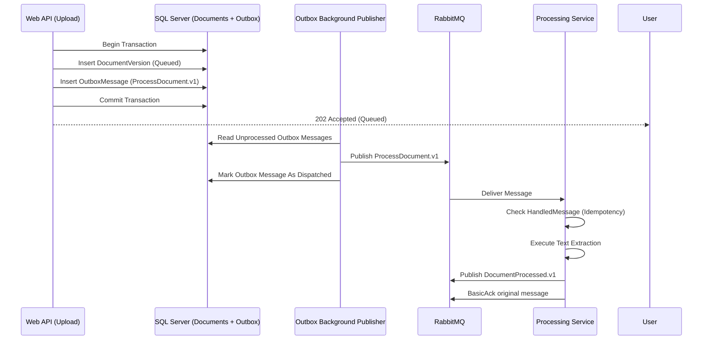

# Architecture: Contracts, Messaging, and Errors

## The 3 Cross-Boundary Messages

Only **three messages** ever cross the boundary between the Main App and the Processing Service via RabbitMQ. 

| Message Name | Type | Direction | Business Meaning |
| --- | --- | --- | --- |
| `ProcessDocument.v1` | Command | Main App $\rightarrow$ Processing | Extract structured text from this stored file. |
| `DocumentProcessed.v1` | Event | Processing $\rightarrow$ Main App | Extraction complete; text is available at `resultKey`. |
| `DocumentProcessingFailed.v1` | Event | Processing $\rightarrow$ Main App | Extraction failed; includes stable `errorCode` and `retryable` flag. |

---

## Message Schemas & Examples

Every message includes header metadata: `messageId`, `correlationId`, `schemaVersion`, and `occurredAt`.

### 1. `ProcessDocument.v1` (Command)

```json
{
  "messageId": "b3f1c2d4-7a1a-4c8d-95cf-0123456789ab",
  "correlationId": "7a91e0aa-1234-5678-90ab-cdef01234567",
  "schemaVersion": 1,
  "jobId": "c58d77e1-4567-89ab-cdef-0123456789ab",
  "versionId": "9e2f4b10-2345-6789-abcd-ef0123456789",
  "storageKey": "originals/2026/10/9e2f4b10.pdf",
  "mimeType": "application/pdf",
  "sha256": "5d41402abc4b2a76b9719d911017c592a8f8d9b1c2e3f4a5b6c7d8e9f0a1b2c3",
  "context": {
    "spaceId": "3fa85f64-5717-4562-b3fc-2c963f66afa6",
    "documentId": "4a762c90-9988-4321-ba98-76543210fedc"
  }
}
```

> [!IMPORTANT]
> **The Opaque Context Field:** The Processing Service **never** inspects `context`. It treats `context` as an opaque JSON block and returns it unchanged in replies so the Main App can easily route domain events to the correct space and document.

### 2. `DocumentProcessed.v1` (Success Event)

```json
{
  "messageId": "d4e5f6a7-8901-2345-6789-abcdef012345",
  "correlationId": "7a91e0aa-1234-5678-90ab-cdef01234567",
  "schemaVersion": 1,
  "jobId": "c58d77e1-4567-89ab-cdef-0123456789ab",
  "versionId": "9e2f4b10-2345-6789-abcd-ef0123456789",
  "resultKey": "results/2026/10/c58d77e1.json",
  "pageCount": 14,
  "context": {
    "spaceId": "3fa85f64-5717-4562-b3fc-2c963f66afa6",
    "documentId": "4a762c90-9988-4321-ba98-76543210fedc"
  }
}
```

### 3. `DocumentProcessingFailed.v1` (Failure Event)

```json
{
  "messageId": "e5f6a7b8-9012-3456-789a-bcdef0123456",
  "correlationId": "7a91e0aa-1234-5678-90ab-cdef01234567",
  "schemaVersion": 1,
  "jobId": "c58d77e1-4567-89ab-cdef-0123456789ab",
  "versionId": "9e2f4b10-2345-6789-abcd-ef0123456789",
  "errorCode": "EXTRACTION_FAILED",
  "retryable": false,
  "context": {
    "spaceId": "3fa85f64-5717-4562-b3fc-2c963f66afa6",
    "documentId": "4a762c90-9988-4321-ba98-76543210fedc"
  }
}
```

---

## Reliable Messaging Patterns



1. **Transactional Outbox:** The Main App writes the `DocumentVersion` row and the `OutboxMessage` row within the same local database transaction. A background publisher polls or listens to dispatch messages to RabbitMQ, guaranteeing zero lost messages even if the broker is temporarily down.
2. **Idempotent Consumers:** Every message consumer checks the unique `messageId` against its local `HandledMessage` table. Duplicate deliveries are immediately acknowledged and skipped.
3. **Dead-Letter Exchange (DLX):** Messages that repeatedly throw unhandled exceptions after $N$ retry attempts are diverted to a dead-letter queue (`dlq.processing`) for manual inspection.

---

## Standardized Error Codes

In accordance with Security Rule #6 (*"Errors use stable codes, never content"*), all HTTP API and message responses use standardized error codes:

| Error Code | Meaning | HTTP Status |
| --- | --- | --- |
| `AUTH_REQUIRED` | Not signed in or session expired | 401 Unauthorized |
| `SPACE_FORBIDDEN` | Role insufficient for requested action | 403 Forbidden |
| `NOT_FOUND` | Resource does not exist, or hidden due to lack of access | 404 Not Found |
| `FILE_TOO_LARGE` | Upload exceeds the 25 MB size limit | 413 Payload Too Large |
| `FILE_TYPE_UNSUPPORTED` | Magic bytes do not match allowed formats | 415 Unsupported Media Type |
| `EXTRACTION_FAILED` | File text could not be extracted (corrupted/locked) | 422 Unprocessable Entity |
| `JOB_NOT_FOUND` | Unknown background processing job | 404 Not Found |
| `RESULT_NOT_READY` | Requested job is still being processed | 409 Conflict |
| `QUERY_INVALID` | Search syntax parse failure (unmatched quotes, etc.) | 400 Bad Request |
| `EDIT_CONFLICT` | Concurrency check failed (optimistic locking) | 409 Conflict |
| `AI_DISABLED` | AI operations requested on a space with `AiEnabled=false` | 409 Conflict |
| `AI_UNAVAILABLE` | Local Ollama container or model is unreachable | 503 Service Unavailable |
| `PROCESSING_UNAVAILABLE` | Processing service down; upload is queued | 503 Service Unavailable |

