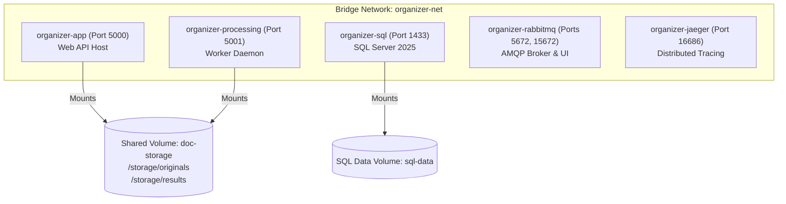

# Setup: Docker Compose Architecture and Configuration

## Container Topology

The entire local development and production environment is managed via a single `docker-compose.yml` located in the `infra/` directory.



---

## Service Port Assignments

| Service Name | Container Name | Internal Port | Host Port | Purpose |
| --- | --- | --- | --- | --- |
| **`app`** | `organizer-app` | `8080` | `5000` | Main Web API & frontend assets |
| **`processing`** | `organizer-processing` | `8080` | `5001` | Worker service health check & jobs endpoint |
| **`sqlserver`** | `organizer-sql` | `1433` | `1433` | Microsoft SQL Server 2025 |
| **`rabbitmq`** | `organizer-rabbitmq` | `5672` | `5672` | AMQP messaging protocol |
| **`rabbitmq-ui`**| *(Same container)* | `15672` | `15672` | RabbitMQ web management console |
| **`jaeger`** | `organizer-jaeger` | `16686` | `16686` | OpenTelemetry distributed trace viewer |

---

## Sample Compose Template (`infra/docker-compose.yml`)

```yaml
version: '3.8'

networks:
  organizer-net:
    driver: bridge

volumes:
  doc-storage:
  sql-data:

services:
  sqlserver:
    image: mcr.microsoft.com/mssql/server:2025-latest
    container_name: organizer-sql
    environment:
      - ACCEPT_EULA=Y
      - MSSQL_SA_PASSWORD=YourStrong@Passw0rd
      - MSSQL_PID=Developer
    ports:
      - "1433:1433"
    volumes:
      - sql-data:/var/opt/mssql
    networks:
      - organizer-net
    healthcheck:
      test: ["CMD-SHELL", "/opt/mssql-tools18/bin/sqlcmd -S localhost -U sa -P 'YourStrong@Passw0rd' -C -Q 'SELECT 1' || exit 1"]
      interval: 10s
      timeout: 5s
      retries: 5

  rabbitmq:
    image: rabbitmq:3.13-management-alpine
    container_name: organizer-rabbitmq
    environment:
      - RABBITMQ_DEFAULT_USER=organizer
      - RABBITMQ_DEFAULT_PASS=organizer_secret
    ports:
      - "5672:5672"
      - "15672:15672"
    networks:
      - organizer-net
    healthcheck:
      test: ["CMD", "rabbitmq-diagnostics", "-q", "ping"]
      interval: 10s
      timeout: 5s
      retries: 5

  jaeger:
    image: jaegertracing/all-in-one:latest
    container_name: organizer-jaeger
    ports:
      - "16686:16686"
      - "4317:4317" # OTLP gRPC
      - "4318:4318" # OTLP HTTP
    networks:
      - organizer-net

  app:
    build:
      context: ..
      dockerfile: infra/Dockerfile.app
    container_name: organizer-app
    depends_on:
      sqlserver:
        condition: service_healthy
      rabbitmq:
        condition: service_healthy
    ports:
      - "5000:8080"
    environment:
      - ConnectionStrings__DefaultConnection=Server=sqlserver;Database=OrganizerDb;User Id=sa;Password=YourStrong@Passw0rd;TrustServerCertificate=True;
      - RabbitMQ__Host=rabbitmq
      - RabbitMQ__Username=organizer
      - RabbitMQ__Password=organizer_secret
      - Storage__RootPath=/storage
      - OTEL_EXPORTER_OTLP_ENDPOINT=http://jaeger:4317
    volumes:
      - doc-storage:/storage
    networks:
      - organizer-net

  processing:
    build:
      context: ..
      dockerfile: infra/Dockerfile.processing
    container_name: organizer-processing
    depends_on:
      rabbitmq:
        condition: service_healthy
    ports:
      - "5001:8080"
    environment:
      - RabbitMQ__Host=rabbitmq
      - RabbitMQ__Username=organizer
      - RabbitMQ__Password=organizer_secret
      - Storage__RootPath=/storage
      - OTEL_EXPORTER_OTLP_ENDPOINT=http://jaeger:4317
    volumes:
      - doc-storage:/storage
    networks:
      - organizer-net
```

